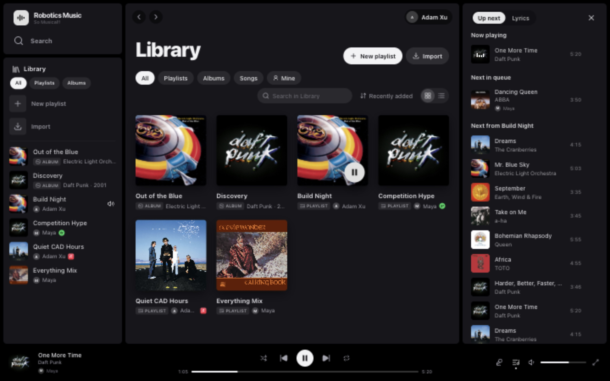
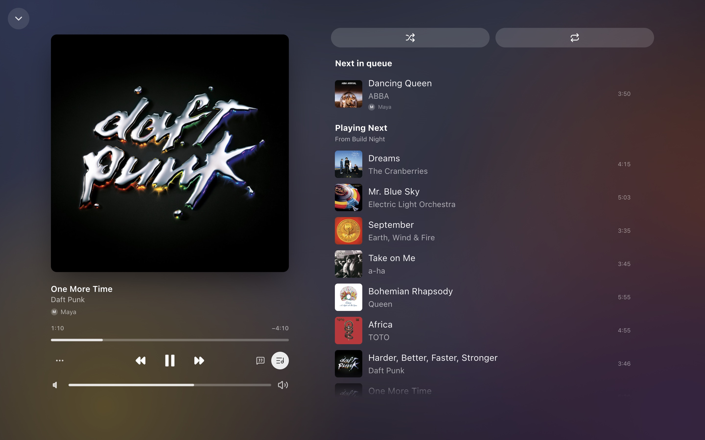
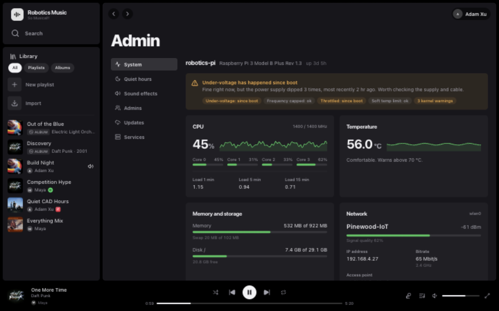

# Robotics Music

A shared jukebox for a room full of people. One Spotify account, one set of speakers, and everyone can search, queue
and control playback from a web app, Slack, an AirPlay device or plain HTTP.

The server is a single Python 3.9+ program with **no dependencies** (stdlib only, no `pip install`). It runs on a
Raspberry Pi in production and on macOS for development.



<table>
  <tr>
    <td width="50%"></td>
    <td width="50%"></td>
  </tr>
  <tr>
    <td align="center"><sub>Now Playing, with who queued each song</sub></td>
    <td align="center"><sub>Admin page: Pi health, quiet hours, updates</sub></td>
  </tr>
</table>

## Features

- **Web app.** Library, search, playlists, queue, synced lyrics, Now Playing. Works on phones, and can be embedded
  in another app's touch panel.
- **Credit for everything.** Every play, skip and queued song shows who did it, in the app and in Slack.
- **Sign in with Slack or Google.** Admins, personal API tokens and bans per person.
- **Slack bot.** A live "Now playing" feed, `/music` search and controls, and Play / Queue buttons on shared links.
- **Links from anywhere.** Spotify, Apple Music and YouTube / YouTube Music links (songs, albums, playlists) are
  matched to Spotify and can be played, queued or imported as playlists.
- **AirPlay receiver.** Anyone can AirPlay to the speakers; Spotify pauses and picks up where it left off afterwards.
- **Quiet hours.** The speakers lock in the evening once the room has been quiet for a few minutes.
- **Sound effects.** Named clips played over the music, e.g. for a match timer.
- **HDMI now-playing screen** drawn straight to the framebuffer, no desktop needed.
- **Self-updating.** The admin page pulls new builds from GitHub without stopping the music.
- **Agent-friendly API.** Every endpoint is documented in [`llms-full.txt`](llms-full.txt) (served at `/llms-full.txt`), so you can point an LLM at it.

## Contents

- [Quick start](#quick-start)
- [How it fits together](#how-it-fits-together)
- [Authentication](#authentication)
- [Web app and accounts](#web-app-and-accounts)
- [Slack bot](#slack-bot)
- [Raspberry Pi setup](#raspberry-pi-setup)
- [Running on the Pi](#running-on-the-pi): admin page, updates, quiet hours, AirPlay, sound effects, HDMI display
- [Running on macOS](#running-on-macos)
- [API reference](#api-reference)
- [Development](#development)

## Quick start

```sh
python3 server.py --client-id <spotify app client id>     # http://127.0.0.1:8765/
python3 server.py auth                                     # log in to the Web API from a terminal or over SSH
python3 server.py --host 0.0.0.0 --token SECRET            # allow other devices on your network
```

Create the Spotify app at [developer.spotify.com/dashboard](https://developer.spotify.com/dashboard) and add
`http://127.0.0.1:8765/auth/callback` as a Redirect URI. Open <http://127.0.0.1:8765/> for the web app, or
`GET /api` for the endpoint list. `python3 server.py --help` lists every flag.

On a Mac this plays through the Spotify desktop app (or any other Connect device). For a dedicated speaker box, see
[Raspberry Pi setup](#raspberry-pi-setup).

## How it fits together

```
 web app / Slack / scripts ──HTTP+SSE──► server.py ──┬─ WebSocket (127.0.0.1) ─► Spotify Soloist ─► PipeWire ─► speakers
                                                     ├─ HTTPS ─► Spotify Web API  (search, library, playlists,   ▲
                                                     │                             history, any Connect device) │
 iPhone / Mac ──AirPlay──► shairport-sync ──────────────────────────────────────────────────────────────────────┘
                                 ├─ metadata pipe ─► server.py (now playing, pauses Spotify while AirPlay plays)
                                 └─ D-Bus RemoteControl ◄─ server.py (play/pause/next/previous back to the sender)
```

There are two playback backends, chosen with `--backend auto|soloist|connect`:

| | `soloist` (Linux) | `connect` (anywhere) |
|---|---|---|
| Plays audio | Locally, through Spotify Soloist | On any Spotify Connect device: desktop app, phone, speaker, librespot |
| Control path | Soloist's local WebSocket: push events, no polling, no rate limits | Web API `/me/player`, polled every 2 s while someone is listening |
| Needs | Soloist API key (Premium) and a one-time pairing | Web API login, Premium on the listening account |
| Queue | Previous + up to 80 upcoming, each tagged context / queue / autoplay | Upcoming only |

`auto` picks Soloist if it's running (or has ever run) on this machine, otherwise `connect`. Anything the Soloist
socket can't do (starting a playlist at a given track, playing an artist or a list of URIs, listing other devices)
falls back to the Web API, targeted at the Soloist device.

### Project layout

| Path | What's there |
|---|---|
| `server.py` | HTTP server, routing, auth, the `auth` subcommand |
| `player.py`, `soloist.py`, `spotify.py` | Playback backends and the Web API client |
| `accounts.py`, `tokens.py` | Slack / Google sessions, admins, bans, API tokens |
| `slack_bot.py` | Slack feed, `/music`, link unfurls and buttons |
| `links.py`, `yt.py` | Apple Music and YouTube link metadata |
| `airplay.py`, `quiet_hours.py`, `effects.py` | AirPlay receiver, quiet hours, sound effects |
| `system_stats.py`, `updater.py` | Admin page system info and self-update |
| `display/` | HDMI now-playing screen |
| `web/` | The web app (React + Vite + Tailwind) |
| `deploy/` | Install scripts, systemd units, shairport-sync config, macOS launchd agent |
| `test_*.py` | Python tests |

## Authentication

There are five separate layers.

1. **Soloist API key.** Generate it at developer.spotify.com/dashboard > *Spotify Soloist API Key* with a Premium
   account. It's passed on every start (`--api-key`), so the [run script](deploy/run-soloist.sh) reads it from
   `~/.config/music-api/env` (mode 600). It's per person: don't share or commit it.
2. **Soloist's Connect session.** No username or password: start Soloist, open the Spotify app on the same network
   and pick the device. Soloist stores the session in `~/.local/share/soloist` and restores it on restart. Free
   accounts can connect once it's set up. Re-pair with `soloist --pair`.
3. **Spotify Web API** (OAuth Authorization Code + PKCE, no client secret). Needed for search, library, playlists,
   history and the `connect` backend. Add `http://127.0.0.1:8765/auth/callback` (or your public
   `https://…/auth/callback`) as a Redirect URI and start with `--client-id`. Then either open `/auth/login` in a
   browser, or on a headless box run `python3 server.py auth` over SSH. You can also open `/auth/login` from your
   phone: Spotify redirects to `127.0.0.1`, which won't load there, so paste that URL into the box on the page.
   Tokens are saved to `~/.local/share/music-api/spotify-tokens.json` (mode 600) and refresh automatically.
4. **This server's API tokens.** `Authorization: Bearer <token>`, or `?token=` for `EventSource`, `` and links.
   Required off-localhost, with `--public` (even from localhost), and as soon as any token exists. Soloist's
   WebSocket has no auth at all, so it stays bound to `127.0.0.1` and this server is the only way in.
5. **Sign in with Slack or Google** for the web app. See [Web app and accounts](#web-app-and-accounts).

### API tokens

Tokens have no scopes: every token can do everything, including managing tokens.

| Route | |
|---|---|
| `GET /api/tokens` | `id`, `name`, `prefix` (to recognize one), `created`, `last_used`, `current` (the one you're calling with) |
| `POST /api/tokens {name?}` | Creates a `mapi_…` token. The response is the only time it's shown. |
| `DELETE /api/tokens/{id}` | Revokes immediately. Revoking the last one is refused (409), so you can't lock yourself out. |

Only SHA-256 hashes are stored, in `<data-dir>/api-tokens.json` (mode 600; the data dir defaults to
`~/.local/share/music-api`). On the first start that requires auth, an existing `<data-dir>/token` is imported and
deleted; if there isn't one, a new token is written there for you to read. `--token` / `$MUSIC_API_TOKEN` also works
as an extra static token that isn't listed and can't be revoked through the API.

To hand someone the web app, create a token and send them `https://…/?token=<token>`; the page remembers it. API
tokens act as admins and show up as "Field" in the app and the activity feed.

## Web app and accounts

The web app lives in [`web/`](web) and is served by `server.py` from `web/dist`.

**Accounts.** People sign in with their Slack account in the workspace and appear under their Slack display name.
The session is an HttpOnly cookie (30 days, stored hashed in `<data-dir>/sessions.json`). Everyone signed in also
gets a personal API token (`mapu_…`, account menu > API) that acts as them; regenerating it revokes the old one.

**Admins and permissions.** Slack users are admins if their user ID or email is in `SLACK_ADMINS` (comma-separated)
or an admin added them on the [admin page](#admin-page). Non-admins can control playback, search, queue, lyrics and
the app's playlists, but get 403 on tokens, the Spotify login, the raw passthrough, the account's library and history,
and hidden playlists. Cookie-authenticated writes from another origin are refused.

**Bans.** Admins can ban someone by Slack ID or email (Admin > Admins). A banned person is locked out of the web
app, their API token, sign-in and the Slack bot. Stored in `<data-dir>/bans.json`.

**Credits.** Every play and queue action is credited to whoever did it (`credit` on `/api/status`, `added_by` on the
queue), saved in `<data-dir>/credits.json` and shown in the app and the Slack feed.

**Playlists.** The app shows every playlist on the Spotify account except those in
`~/.config/music-api/hidden-playlists.json` (`{"playlists": ["<id>" or {"id", "name"}, ...]}`). Playlists created or
imported in the app are credited to their creator (`<data-dir>/app-playlists.json`); only they or an admin can rename
or delete them, and anyone can add or remove tracks. Importing copies a *public* playlist into a new private one.
Spotify only exposes the first 100 tracks of playlists the account doesn't own, so that's the cap.

**Apple Music and YouTube links** are read for titles, artists and lengths only (`links.py`, `yt.py`) and matched to
Spotify songs; nothing plays from them. YouTube / YouTube Music songs, albums and public or unlisted playlists (up to
500 songs) work from `youtube.com`, `music.youtube.com`, `youtu.be`, Shorts and embed links. Metadata comes from
YouTube Music's public InnerTube endpoints with oEmbed as the fallback for single videos; if YouTube starts rejecting
requests, bump `yt.CLIENT_VERSION`. Private lists, mixes and channel links are refused.

<details>
<summary><b>Embedding the app in another page</b></summary>

Add `&embed=<host>` when another app frames the web app with its own player bar: the bottom player bar, top bar and
New playlist / Import buttons are hidden and Up next opens by default. `embed=fms` (the FMS touch panel) also swaps
the icons for SF Symbols (`web/src/embed`, font rebuilt by `web/scripts/subset-sf-font.sh`), enlarges everything for
touch, uses the panel's black and green, and posts swipes that start on the top edge to the panel so it can slide the
app away.

Only origins in `MUSIC_API_FRAME_ANCESTORS` (CSP `frame-ancestors`, default `localhost:8080` and `fms.local:8080`)
may frame the app.
</details>

<details>
<summary><b>Setting up Sign in with Slack</b></summary>

Create a Slack app from the [manifest below](#slack-bot), install it to the workspace, and put
`SLACK_CLIENT_ID`, `SLACK_CLIENT_SECRET`, `SLACK_BOT_TOKEN` (`xoxb-…`) and `SLACK_REDIRECT_URI` in
`~/.config/music-api/env`. The bot token is used for `users.info` (display names), `auth.test` (the workspace ID
sign-ins must match) and the Slack bot.
</details>

<details>
<summary><b>Setting up Sign in with Google</b></summary>

An alternative for accounts in one Google Workspace domain (`GET /auth/google/login`, callback
`/auth/google/callback`; `GET /auth/methods` returns `{"slack": bool, "google": bool}`). The Google email is mapped to
the Slack user with the same email (`users.lookupByEmail`), so the session, name, avatar, admin rights and personal
token are identical to signing in with Slack. Accounts that aren't verified, aren't in the allowed domain, or aren't
in the Slack workspace are refused.

1. Google Cloud console > APIs & Services > Credentials > Create credentials > OAuth client ID > Web application.
   Authorized redirect URI: `https://<your host>/auth/google/callback`.
2. OAuth consent screen: user type **Internal** if available, scopes `openid email profile`.
3. In `~/.config/music-api/env` set `GOOGLE_CLIENT_ID`, `GOOGLE_CLIENT_SECRET`, and optionally `GOOGLE_REDIRECT_URI`
   (default `<MUSIC_API_URL>/auth/google/callback`, else `http://127.0.0.1:<port>/auth/google/callback`) and
   `GOOGLE_ALLOWED_DOMAIN` (default `pinewood.edu`).
4. Add the bot scope `users:read.email` to the Slack app and reinstall it. Without it, Google sign-in shows "isn't
   fully set up yet".
</details>

## Slack bot

Set `SLACK_SIGNING_SECRET` (Basic Information > Signing Secret) and invite the bot to the channel
(`SLACK_MUSIC_CHANNEL`, default `#music`). Without the secret the bot stays off and the server starts normally.

- **Live feed.** Every track change posts one "Now playing" message: art, title, who queued it, the next 3 songs,
  and Play/Pause, Skip and More Controls buttons. It's edited on pause, resume and queue changes (at most every 5 s)
  and shrinks to a compact "Played" line when the track changes.
- **`/music`.** `/music <query>` searches with Add to queue / Play buttons; also `now`, `queue`, `play`, `pause`,
  `skip` and `help`. A Spotify link after `/music` works too. Skips, pauses and plays are announced with who did them.
- **Links.** Spotify, Apple Music and YouTube links shared in Slack unfurl with Add to queue / Play / Import as
  playlist buttons. A link posted in the music channel gets one threaded reply with a card per link (up to 3): Play
  now, Queue, and Add to Library / Import to Library.
- **Credit.** Tracks queued from Slack are credited to that person, so the web app shows "Added by".
- **Security.** `/slack/*` requests are verified with the signing secret (v0 HMAC, 5 minute window) and only accepted
  from the workspace.

<details>
<summary><b>Slack app manifest</b></summary>

Replace `music.example.org` with your host.

```yaml
display_information:
  name: Robotics Music
  description: So Musical!!
features:
  bot_user:
    display_name: Robotics Music
    always_online: true
  slash_commands:
    - command: /music
      url: https://music.example.org/slack/commands
      description: Search, queue and control the lab speakers
      usage_hint: "[song, artist, link | now | queue | play | pause | skip | help]"
      should_escape: false
  unfurl_domains:
    - open.spotify.com
    - music.apple.com
    - youtube.com
    - music.youtube.com
    - youtu.be
oauth_config:
  redirect_urls:
    - https://music.example.org/auth/slack/callback
  scopes:
    user: [openid, profile, email]
    bot: [users:read, chat:write, commands, links:read, links:write]
settings:
  event_subscriptions:
    request_url: https://music.example.org/slack/events
    bot_events: [link_shared]
  interactivity:
    is_enabled: true
    request_url: https://music.example.org/slack/interactions
  org_deploy_enabled: false
  socket_mode_enabled: false
  token_rotation_enabled: false
```

After changing scopes, reinstall the app so the bot token picks them up. The manifest only applies to new apps: for
an existing one, add any missing domains under *Event Subscriptions > App Unfurl Domains*, or those links won't
unfurl.
</details>

## Raspberry Pi setup

Tested on a **Pi 3 B+** (also fine: Pi 4/5, Zero 2 W) with **Raspberry Pi OS Lite 64-bit** and USB speakers. No
cooling needed, but use a proper 5 V / 2.5 A supply (`vcgencmd get_throttled` should print `0x0`).

1. Copy the repo to the Pi and run the installer:
   ```sh
   scp -r music-api pi@music.local:
   ssh pi@music.local 'cd music-api && sh deploy/install-linux.sh'
   ```
   It installs PipeWire, the AirPlay receiver (`NO_AIRPLAY=1` skips it), `ffmpeg` and `pw-play`, enables lingering
   so user services run without a login, installs systemd user units (Soloist, the API, AirPlay, the display, the
   quiet-hours timer and a daily Soloist update) and creates `~/.config/music-api/env`.
2. Fill in `~/.config/music-api/env`: `SOLOIST_API_KEY`, `DEVICE_NAME`, `SPOTIFY_CLIENT_ID`
   (see [`deploy/env.example`](deploy/env.example) for everything else).
3. Pick the output: `wpctl status`, find the speakers under *Sinks*, then `wpctl set-default <id>` (or put the node
   name in `SOLOIST_PIPEWIRE_DEVICE`).
4. `systemctl --user start soloist music-api`, then pick `DEVICE_NAME` once in the Spotify desktop or mobile app on
   the same Wi-Fi to pair Soloist (the web player only lists devices that are already logged in).
   `soloist ctl status` should say logged in. Pairing uses mDNS, so the app must be on the Pi's subnet; see
   [Pairing from another subnet](#pairing-from-another-subnet) if it isn't.
5. Log in to the Web API over SSH:
   `python3 ~/.local/share/music-api-v2/server.py auth --client-id <id>` and paste the redirected URL. It doesn't open
   a port, so the service can keep running; then `systemctl --user restart music-api`.
6. Get your first API token with `cat ~/.local/share/music-api/token` and test it:
   ```sh
   curl -H "Authorization: Bearer <token>" http://music.local:8765/api/status   # "backend": "soloist"
   ```
   From then on, manage tokens with `/api/tokens` and delete that file.
7. Logs: `journalctl --user-unit soloist --user-unit music-api -f`. Pi OS keeps the journal in RAM, so plain
   `journalctl --user` finds nothing.

Set the Pi's timezone (`sudo timedatectl set-timezone America/Los_Angeles`) for quiet hours; the installer warns if
it's UTC.

### Public access with a Cloudflare tunnel

For access from outside the network, run a named Cloudflare tunnel as a system `cloudflared` service on the Pi. The API runs with `--public`,
because tunnelled requests arrive from `127.0.0.1` and would otherwise skip the token check. Install `cloudflared`
from [pkg.cloudflare.com](https://pkg.cloudflare.com/index.html), then:

```sh
cloudflared tunnel login                                    # pick your zone in the browser
cloudflared tunnel create music-api
cloudflared tunnel route dns -f music-api music.example.org
sudo mkdir -p /etc/cloudflared && sudo cp ~/.cloudflared/<tunnel-id>.json /etc/cloudflared/
sudo tee /etc/cloudflared/config.yml <<EOF
tunnel: <tunnel-id>
credentials-file: /etc/cloudflared/<tunnel-id>.json
ingress:
  - hostname: music.example.org
    service: http://127.0.0.1:8765
  - service: http_status:404
EOF
sudo cloudflared service install
```

Logs: `journalctl -u cloudflared -f`.

### Pairing from another subnet

Spotify apps find unpaired Connect devices over mDNS, which doesn't cross routers. If your computer is on another
subnet but can reach the Pi by IP, relay Soloist's pairing port through the computer and advertise it there (macOS
shown; get the port and path with `avahi-browse -rt _spotify-connect._tcp` on the Pi):

```sh
ssh -N -g -L 0.0.0.0:<port>:127.0.0.1:<port> ubuntu@<pi-ip> &
dns-sd -R "PEARL Speakers" _spotify-connect._tcp local <port> Stack=SP VERSION=1.0 CPath=/zc
```

Restart the Spotify desktop app, pick the device, then stop both commands. Advertising the Pi's own address
(`dns-sd -P … <pi-ip>`) doesn't work: the app ignores devices that resolve to another subnet.

### Hardware notes

- **Pi Zero W and Pi 1 (ARMv6) can't run Soloist.** Spotify only ships armv7, arm64 and x86_64 builds. Use a Pi
  Zero 2 W instead, or run the API with `--backend connect` and build an unofficial
  [librespot](https://github.com/librespot-org/librespot) for ARMv6 as the speaker.
- **Soloist builds expire** 90 days after they're built (exit code 10).
  [`deploy/update-soloist.sh`](deploy/update-soloist.sh) runs daily and pulls the current build from Spotify's CDN.
  Spotify asks that the binary not be redistributed, so it's never committed here.
- **Speakers.** Soloist outputs through PipeWire (falling back to PulseAudio). Set `SOLOIST_PIPEWIRE_DEVICE`, or
  make them the default with `POST /api/system/outputs {id}`.

## Running on the Pi

### Admin page

Admins get **Admin** in the account menu (`/admin`), backed by `/api/admin/*`:

| Tab | |
|---|---|
| **System** | CPU (overall and per core) and temperature with 10 minute sparklines, load, under-voltage and throttling (now and since boot), memory, disk, Wi-Fi, service states and versions. Sampled every 5 s and cached, so polling every 2 s is cheap on a Pi 3. |
| **Quiet hours** | Change the window and grace period, skip tonight, or lock now. See [Quiet hours](#quiet-hours). |
| **Sound effects** | Effects volume and whether they play during quiet hours. See [Sound effects](#sound-effects). |
| **Admins** | Add admins (people who have signed in, or by Slack ID / email) and ban or unban people. Config admins can't be removed here, and nobody can remove the last admin. |
| **Updates** | Compares the deployed commit with GitHub and updates without stopping the music. |
| **Services** | Restart Soloist, AirPlay or the display, and read each unit's recent journal. |

### Updates from GitHub

On every push to `main`, [`.github/workflows/pi-build.yml`](.github/workflows/pi-build.yml) runs the Python tests,
builds `web/dist` and force-pushes the deployable tree (plus `BUILD.json`) to the `pi-build` branch.

On the Pi, `updater.py` keeps a bare clone (`~/.local/share/music-api-repo.git`) that fetches over HTTPS. The repo is
public, so there's nothing to set up: the clone is created on the first fetch. An update:

1. stages `pi-build` in `music-api-v2.new` and swaps it in (the old tree stays as `music-api-v2.prev`),
2. installs changed unit files that are already installed,
3. restarts `music-api` only if Python files changed, and `music-display` only if its files changed,
4. checks `/api/status`, and swaps back if that fails.

Soloist and the AirPlay receiver are never restarted, and anything that needs sudo is listed as a note instead of
being run. The update runs as a transient `systemd-run --user` unit so it survives the restart; progress goes to
`<data-dir>/update.json`.

`python3 ~/.local/share/music-api-v2/updater.py status` shows what an update would do, and `python3 updater.py update`
does the same as the button. To pull from a fork, set `MUSIC_API_UPDATE_REMOTE`; an SSH remote also needs a deploy
key, which `python3 updater.py setup` generates. [`deploy/deploy-pi.sh`](deploy/deploy-pi.sh) still works for
copying straight from a laptop.

### Quiet hours

Set by `QUIET_HOURS` (env file or `--quiet-hours`; default `21:00-08:00` local time, may wrap midnight, `off`
disables it).

1. **Grace.** When the window starts nothing is cut off. Whatever is playing keeps going, and people can keep
   playing, skipping and starting AirPlay sessions.
2. **Locked.** Once no audio has come from any source for 5 minutes (counted from the window start if it was already
   quiet, so an idle evening locks at 21:05), the speakers lock until the window ends. Play, resume, skip, jump and
   transfer-with-play return `423 {"error": "quiet_hours", "until": "08:00", ...}` from every route, the Slack bot
   and the raw passthrough. Pause, volume, search, playlists and queue editing keep working. The AirPlay receiver
   stops advertising and every output is muted.
3. **Morning.** Both are restored, with each output's previous mute state.

`GET /api/quiet-hours` and `status.quiet_hours` report `{window, phase: open|grace|locked, idle_since, locks_at, until}`.

<details>
<summary><b>How the lock survives restarts</b></summary>

- The lock and the idle clock live in `<data-dir>/quiet-hours.json`. A reboot during the window comes up locked if
  it was locked, otherwise in grace with the saved idle clock.
- `quiet-hours.timer` runs `quiet_hours.py sync` every minute as an OS-level backstop: it applies or undoes the lock,
  and if the server's heartbeat is older than 150 s it judges idleness itself from PipeWire sink activity and locks
  on its own.
- `airplay.service` has `quiet_hours.py receiver-allowed` as its `ExecCondition`, so the receiver can't come back
  while locked.
- Settings changed on the admin page are saved in `<data-dir>/quiet-hours-settings.json` and take precedence over
  `QUIET_HOURS` (Reset goes back to it).
</details>

### AirPlay receiver

The Pi also shows up as an AirPlay speaker named `AIRPLAY_NAME` (default "PEARL Speakers"), using classic AirPlay
(no multi-room). AirPlay takes over from Spotify:

- A session starting pauses Spotify (track, position and queue stay put).
- While it lasts, `/api/status` shows the AirPlay song (`source: "airplay"`, art at `/api/airplay/artwork`,
  `airplay.sender`), and the Slack feed posts it, credited to the sender's device.
- Play, pause, next and previous (from the API, the web app and Slack) control the sender through shairport-sync's
  D-Bus `RemoteControl`. Senders without remote control get `409 airplay_remote_unavailable`. Other Spotify transport
  (play a track, seek, transfer) returns `409 airplay_active`.
- When it ends (the sender stops, or someone presses Stop AirPlay / `POST /api/airplay/stop`), Spotify resumes if it
  was playing before, unless quiet hours have locked.

<details>
<summary><b>How it's installed</b></summary>

[`deploy/install-airplay.sh`](deploy/install-airplay.sh) installs the distro `shairport-sync` package (built with
PulseAudio output, the metadata pipe, D-Bus/MPRIS and MQTT), disables its system service and checks those features.
shairport-sync then runs as the `airplay.service` user unit, so it can reach the user's PipeWire and session bus, with
[`deploy/shairport-sync.conf`](deploy/shairport-sync.conf): metadata and cover art go to
`/tmp/shairport-sync-metadata`, which the server reads (`--airplay-pipe`). A missing pipe is fine (macOS, or no
receiver installed). Remote control needs `busctl` and `dbus-user-session`. A server restart mid-song loses the
session until the next song starts.

Logs: `journalctl --user-unit airplay -f`.
</details>

### Sound effects

Register short clips by name and play them over whatever else is playing, e.g. for a match timer.

```sh
curl -X POST -H "Authorization: Bearer $T" -H "Content-Type: audio/wav" \
     --data-binary @start.wav "https://music.example.org/api/effects?name=match-start"
curl -X POST -H "Authorization: Bearer $T" https://music.example.org/api/effects/match-start/play \
     -d '{"volume": 100, "duck": true}'
```

- Register with the audio as the body (wav, mp3, ogg or flac, or multipart, or JSON `{name, url}`);
  `GET/PATCH/DELETE /api/effects/{name}` read, rename and delete. Registering and deleting are admin-only.
- `POST /api/effects/{name}/play {volume?, duck?, duck_level?}` returns immediately; `POST /api/effects/stop` stops
  everything. Up to 16 plays can overlap, each its own `pw-play` stream mixed with the music.
- Volume follows the music slider by default (`volume` x slider / 100). Admins can switch to a fixed effects volume.
- `duck: true` lowers the other streams to `duck_level` % (default 30) while the effect plays.
- Uploads are converted once with ffmpeg to 48 kHz stereo WAV and stored in `<data-dir>/effects/`. Without ffmpeg
  only PCM WAV is accepted.
- By default effects still play while quiet hours are locked (briefly unmuting only the outputs the lock muted).
  They never count as playback. Turn this off on the admin page to get `423 quiet_hours` instead.

### HDMI now-playing display

[`display/now_playing_display.py`](display/now_playing_display.py) draws a now-playing screen (blurred artwork
background, big cover, title, progress, "Playing Next") straight into `/dev/fb0`, with no desktop. It needs only
`python3-pil` and `fonts-inter` and follows `/api/events`.

- AirPlay shows the sender's song with "AirPlay from <sender>".
- When nothing is playing it powers the HDMI output down (`FBIOBLANK`, so the monitor goes to standby) and wakes
  instantly when something plays.
- It works at any resolution (16 or 32 bpp).
- Create its token once: `POST /api/tokens {"name": "pi display"}` into `~/.config/music-api/display-token` (mode 600).
- Preview without a framebuffer: `python3 display/now_playing_display.py --render-png /tmp/shot.png --size 1920x1080`.

<details>
<summary><b>Monitor shows a stretched, clipped image after waking</b></summary>

If the Pi can't read the monitor's EDID when it wakes, the kernel falls back to 1024x768 while the framebuffer stays
1920x1080. Pin the EDID while the mode is right:

```sh
sudo mkdir -p /lib/firmware/edid && sudo cp /sys/class/drm/card0-HDMI-A-1/edid /lib/firmware/edid/monitor.bin
# append to the single line in /boot/firmware/cmdline.txt:
drm.edid_firmware=HDMI-A-1:edid/monitor.bin video=HDMI-A-1:1920x1080@60D
```

Also add an `/etc/initramfs-tools/hooks/edid` hook that copies the file into `$DESTDIR/lib/firmware/edid/`, run
`sudo update-initramfs -u` and reboot. `kmsprint` should show the CRTC at 1920x1080.
</details>

## Running on macOS

There's no Soloist on a Mac, so `auto` picks the `connect` backend and plays on the Spotify desktop app or any other
Connect device. To keep it running, use the launchd agent in
[`deploy/macos/`](deploy/macos/org.pinewoodrobotics.music-api.plist): copy it to `~/Library/LaunchAgents/`, adjust the
paths and client ID, and `launchctl bootstrap gui/$(id -u) <plist>`. It runs
`python3 server.py --public --client-id <id>` with output in `server.log`.

```sh
launchctl kickstart -k gui/$(id -u)/org.pinewoodrobotics.music-api    # restart after a code change
```

For Web API login through a public URL, add `https://<your host>/auth/callback` as a Redirect URI in the Spotify app
and pass it with `--redirect-uri`. Otherwise use the paste flow.

## API reference

`GET /api` lists every endpoint. These docs are served without a token, so an LLM agent can read them directly:

| | |
|---|---|
| [`/llms.txt`](llms.txt) | Short index in the [llms.txt](https://llmstxt.org) format |
| [`/llms-full.txt`](llms-full.txt) | The whole reference in one file: endpoints, response shapes, curl examples, workflows, limits |
| [`/API.md`](API.md) | One row per endpoint, generated from the route docstrings |

A few routes that go beyond Spotify's own API:

| Route | |
|---|---|
| `GET /api/events` | Server-sent events for status, queue and activity |
| `GET /api/lyrics` | Synced lyrics from [LRCLIB](https://lrclib.net), with the current line |
| `POST /api/sleep {minutes, fade}` | Sleep timer that fades out, pauses and restores the volume |
| `/api/system/volume`, `/api/system/outputs` | The machine's own mixer (PipeWire / PulseAudio / macOS) |
| `GET /api/artwork?proxy=1` | Cover image bytes, for microcontroller clients that can't do HTTPS |
| `ANY /api/spotify/{path}` | Raw Web API passthrough using the stored login |
| `/api/airplay`, `/api/quiet-hours`, `/api/effects` | See the sections above |

### Spotify Web API limits

Development-mode apps (2026 rules):

- The app owner needs Premium, and a new app gets at most 5 users (add them under *User Management*).
- Search returns at most 10 results per type per page; page with `offset`.
- Playlist items only come back for playlists you own or collaborate on. Any playlist can still be played by URI.
- Removed by Spotify, so not available here: browse/categories, new releases, artist top tracks, recommendations,
  audio features, related artists, popularity and batch lookups.

## Development

```sh
python3 -m unittest discover -p 'test_*.py'      # Python tests (also run in CI)
python3 gen_api_md.py > API.md                   # regenerate API.md after changing a route

cd web && npm install
npm run dev                                      # Vite dev server
npm run build                                    # writes web/dist, which server.py serves
npm run lint
```

Open the dev server with `?mock=full` to run the web app against built-in fake data, with no backend
(`web/src/dev/mock.ts`; other modes: `signedout`, `writes`, `down`). The screenshots above come from it.

`llms.txt` and `llms-full.txt` are written by hand: update them when you add or change a route.
